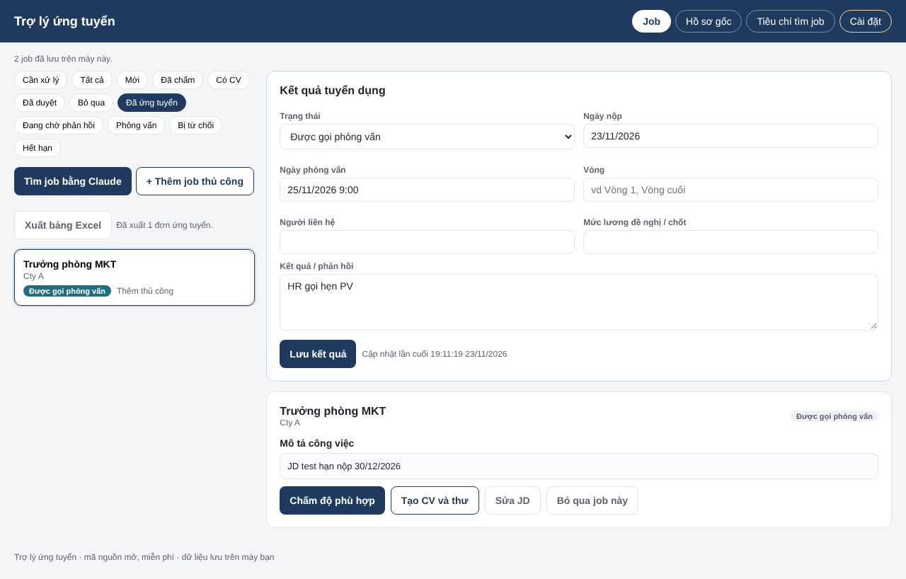
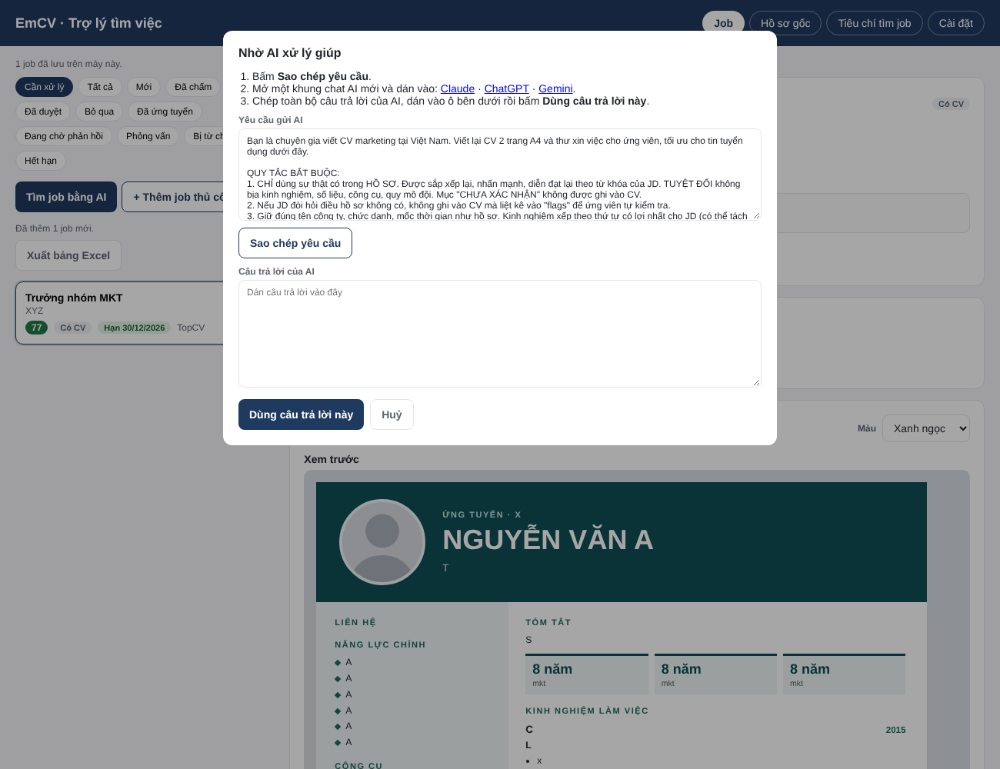

# EmCV – Trợ lý tìm việc

**Dùng ngay:** https://tunupvn.github.io/EmCV-trolytimviec/

Công cụ miễn phí giúp người tìm việc ở Việt Nam bớt việc lọc tin và sửa CV thủ công:

- **Tìm job** trên TopCV, VietnamWorks, CareerViet, Glints, JobsGO… theo tiêu chí của bạn. Tin đã hết hạn tự bị loại.
- **Chấm độ phù hợp** giữa hồ sơ của bạn và từng tin tuyển dụng, chỉ ra điểm mạnh, khoảng trống và câu nên hỏi nhà tuyển dụng.
- **Viết lại CV 2 trang A4 và thư xin việc** cho từng job, chỉ dùng kinh nghiệm thật trong hồ sơ gốc của bạn, không bịa thêm.
- **Bạn duyệt, sửa, rồi tự nộp.** App không tự gửi gì cho nhà tuyển dụng.
- **Theo dõi kết quả:** đã nộp, được gọi phỏng vấn, chờ kết quả, nhận offer, bị từ chối…, kèm ngày phỏng vấn, vòng, người liên hệ, phản hồi.
- **Nhận diện bản chất vị trí** khi chấm điểm: thực chất là quảng cáo chuyển đổi, thương hiệu, cân bằng hay JD mơ hồ, kèm câu hỏi nên hỏi HR trước khi đi phỏng vấn.
- **Soạn email trả lời nhà tuyển dụng**: xác nhận lịch phỏng vấn, xin đổi lịch, từ chối lịch sự hoặc cảm ơn sau phỏng vấn. Soạn nhanh theo mẫu, hoặc dán email mời để AI viết thư và tự điền giờ, người liên hệ, vòng phỏng vấn.
- **Xuất bảng Excel** (.xlsx) gồm tổng quan theo trạng thái, danh sách đơn đã ứng tuyển và các job chưa nộp.

Tất cả nằm trong **một file `index.html`**, không cần cài đặt, không có máy chủ. Dữ liệu lưu ngay trong trình duyệt của bạn.

## Dùng ngay

**Cách 1, trên web:** mở https://tunupvn.github.io/EmCV-trolytimviec/

**Cách 2, trên máy:** tải file `index.html` về rồi mở bằng Chrome, Edge hoặc Firefox.

## Cần chuẩn bị: chọn một trong hai chế độ

### 1. Sao chép prompt: miễn phí (mặc định)

Không cần API key, dùng được với **Claude Free, ChatGPT hay Gemini bản miễn phí**.

Mỗi lần bấm chấm điểm, tạo CV hay tìm job, app hiện một hộp thoại:
1. Bấm **Sao chép yêu cầu**.
2. Mở khung chat AI mới ([Claude](https://claude.ai/new), [ChatGPT](https://chatgpt.com/), [Gemini](https://gemini.google.com/app)) và dán vào.
3. Chép toàn bộ câu trả lời, dán lại vào app, bấm **Dùng câu trả lời này**.

App tự đọc kết quả rồi dựng CV, thư xin việc và bảng điểm như chế độ tự động.

> Khi **tìm job**, hãy bật tính năng tìm kiếm web trong khung chat (nếu AI bạn dùng có). Nếu không, AI có thể trả về tin cũ hoặc tự bịa. Luôn mở link kiểm tra lại.

### 2. Tự động: dùng Claude API key (trả phí)

Không cần sao chép qua lại. Lưu ý: gói Claude Free hay Pro **không** bao gồm API, API được tính phí riêng.

1. Đăng ký tại [console.anthropic.com](https://console.anthropic.com), nạp credit.
2. Vào **Settings → API Keys**, tạo key mới (dạng `sk-ant-...`).
3. Trong app, vào **Cài đặt**, chọn chế độ **Tự động**, dán key, bấm **Kiểm tra kết nối** rồi **Lưu cài đặt**.

Chi phí tính theo lượng dùng, xem bảng giá tại [claude.com/pricing](https://claude.com/pricing#api). Tìm job tốn hơn vì Claude phải tìm trên web; nếu tài khoản thuộc một tổ chức, quản trị viên cần bật web search trong Console.

## Cách dùng

1. **Hồ sơ gốc:** điền họ tên, liên hệ, ảnh, và toàn bộ kinh nghiệm thật theo mẫu có sẵn. Ghi càng cụ thể (số liệu, kết quả) thì CV càng mạnh. Mục *"Chưa xác nhận"* là những thứ bạn chưa làm, để AI không tự đưa vào CV.
2. **Tiêu chí tìm job:** từ khóa vị trí (mỗi dòng một), địa điểm, ưu tiên, loại trừ.
3. **Job:** bấm **Tìm job bằng AI**, hoặc **+ Thêm job thủ công** rồi dán JD.
4. Với mỗi job:
   - Mở link, chép JD đầy đủ vào **Sửa JD**. Kết quả tìm kiếm thường chỉ có tóm tắt, và các trang tuyển dụng hay chặn đọc tự động.
   - Kiểm tra **hạn nộp**. Nhãn vàng nghĩa là chưa rõ hạn.
   - **Chấm độ phù hợp**, rồi **Tạo CV và thư**.
   - Xem trước, sửa nhanh, đổi màu, rồi **In / Lưu CV thành PDF**. Trong hộp thoại in, chọn *Lưu thành PDF*, khổ A4, lề *Không*, bật *Đồ họa nền*. File PDF có chữ thật, hệ thống lọc CV tự động (ATS) đọc được.
   - Sao chép thư, tự nộp, rồi bấm **Đánh dấu đã nộp**.
5. Khi có phản hồi, mở job trong mục **Đã ứng tuyển** và cập nhật ô **Kết quả tuyển dụng**. Nhận được email mời phỏng vấn thì dùng phần **Trả lời email mời phỏng vấn** ngay bên dưới. Bấm **Xuất bảng Excel** để có file theo dõi.

## Dữ liệu và quyền riêng tư

- Hồ sơ, job và API key chỉ lưu trong trình duyệt của bạn (localStorage), không có máy chủ trung gian.
- Ở chế độ tự động, nội dung hồ sơ và JD được gửi thẳng tới `api.anthropic.com`. Ở chế độ sao chép prompt, bạn tự dán nội dung vào AI mình chọn, nên hãy đọc qua trước khi gửi.
- Xóa dữ liệu trình duyệt hoặc đổi máy sẽ **mất dữ liệu**. Hãy dùng **Cài đặt → Xuất file sao lưu** thường xuyên. File sao lưu không chứa API key.
- Đừng dùng app trên máy tính công cộng, vì API key nằm trong trình duyệt.

## Tự triển khai bản riêng

Bấm **Fork** để có bản của riêng bạn, rồi vào **Settings → Pages**, chọn branch `main`, thư mục `/ (root)`, bấm **Save**. Hoặc chỉ cần tải file `index.html` về và mở bằng trình duyệt.

## Giới hạn

- Kết quả tìm job phụ thuộc vào công cụ tìm kiếm. Có thể sót tin, và đôi khi có tin cũ lọt qua, nên luôn mở link kiểm tra.
- AI được dặn không bịa kinh nghiệm, nhưng bạn vẫn phải **đọc lại CV trước khi nộp**.
- Mẫu CV hiện tối ưu cho tiếng Việt, 2 trang A4. Nội dung dài quá sẽ có cảnh báo tràn trang.

## Tác giả

**Đỗ Thanh Tùng**: marketing, thương hiệu và ứng dụng AI.

Hơn 10 năm làm marketing, trong đó 8 năm trong giáo dục, đào tạo. Ngoài công việc, tôi tự xây các công cụ AI để làm việc nhanh hơn, như [Tun Ideas](https://github.com/TunUpVN/tun-ideas) (phòng chat nhiều AI) và EmCV.

EmCV ra đời khi tôi đi tìm việc và thấy việc lọc tin, sửa CV cho từng vị trí quá mất thời gian. Tôi chia sẻ miễn phí, mong giúp được bạn bớt vất vả hơn.

Tôi đang tìm cơ hội mới ở vị trí quản lý marketing, thương hiệu. Nếu bạn đang tuyển hoặc muốn góp ý cho EmCV, rất mong nhận được thư của bạn.

- Email: dttung.2191@gmail.com
- GitHub: [github.com/TunUpVN](https://github.com/TunUpVN)

Góp ý, báo lỗi: mở mục [Issues](https://github.com/TunUpVN/EmCV-trolytimviec/issues) của repo.

## Giấy phép

[MIT](LICENSE): dùng, sửa, chia sẻ tự do.
